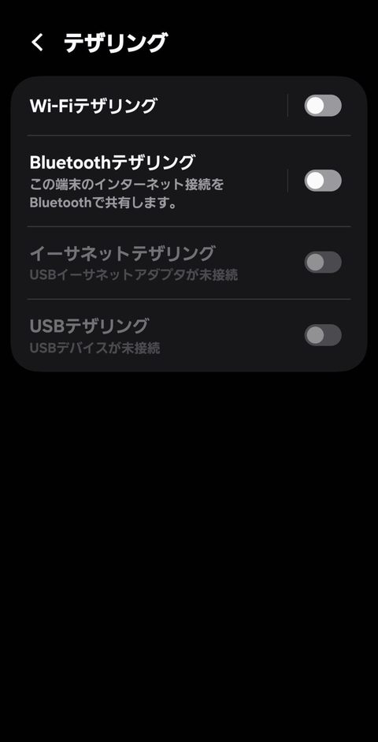

> **この記事でわかること**
> - 帰省先からIP制限のある社内ツールに入れるかは、まず「会社のルール」と「会社支給のVPN」で決まります
> - 出発前に、自宅以外の回線（スマホのテザリングなど）で接続テストをしておけば、当日のトラブルを減らせます
> - 個人で契約する固定IPは「会社が登録を認めた場合だけ」の選択肢です。契約しなくていい人も多くいます

## 結論：最初に確認するのは会社のルールと支給VPN。個人の固定IPは「会社が許可した場合だけ」の選択肢

年末年始に実家から働く予定があるなら、出発前に次の順番で確認してください。

1. **会社のルールを確認する**：テレワーク規程に、働いてよい場所・使ってよい回線・私物の機器やサービスの扱いが書かれていないか読み、分からない点は情シス（情報システム部門）に聞く
2. **支給VPNを事前にテストする**：会社のVPNやリモート接続の仕組みがあるなら、自宅の光回線以外（テザリングなど）でつながるかを出発前に試す
3. **帰省先の回線の注意点を知っておく**：テザリングのデータ容量、実家Wi-Fiの状態、公衆Wi-Fiを使うときの基本的な注意
4. **個人で固定IPを契約するのは最後の選択肢**：会社が「個人の固定IPを許可リストに登録する」と認めた場合だけ検討する

この記事では、会社のIP制限を無断で回避する方法は扱いません。IP制限は会社がセキュリティのために設けている仕組みです。自己判断で回避すると、つながったとしても規程違反になるおそれがあります。

## 帰省先だとIPアドレスが変わる理由（自宅回線・実家回線・テザリングの違いを図解）

IP制限とは、「登録済みのIPアドレスから来たアクセスだけを通す」仕組みです。社内ツールが見ているのは、PCそのものではなく、**インターネットに出ていくときの回線のIPアドレス（グローバルIPアドレス）**です。そのため、同じ会社PCを持っていっても、つなぐ回線が変われば社内ツールから見えるIPアドレスも変わります。

```
【自宅】   会社PC → 自宅ルーター → 自宅の光回線 → インターネット → 社内ツール
                                   └ 社内ツールに見えるIP：自宅回線のIP

【実家】   会社PC → 実家ルーター → 実家の回線   → インターネット → 社内ツール
                                   └ 社内ツールに見えるIP：実家回線のIP（自宅とは別）

【テザリング】会社PC → スマホ → 携帯キャリアの回線 → インターネット → 社内ツール
                                   └ 社内ツールに見えるIP：キャリア側のIP（変わりやすく、ほかの利用者と共有されることもある）

【会社VPN】 会社PC → どの回線でも → 会社のVPN装置 → インターネット → 社内ツール
                                   └ 社内ツールに見えるIP：会社のIP（構成による）
```

それぞれの回線の特徴は次のとおりです。

| 回線 | 社内ツールから見えるIP | 注意点 |
|---|---|---|
| 自宅の光回線 | 自宅回線のIP | 固定IP契約でなければ、自宅回線のIPも変わることがある |
| 実家の回線 | 実家回線のIP | 自宅とは別のIP。会社に登録されていなければIP制限で弾かれる |
| スマホのテザリング | キャリア側のIP | 接続のたびに変わりやすい。共有されている場合もある |
| 会社支給のVPN経由 | 会社側のIP（構成による） | 回線を問わず同じ出口になる設計が多いが、会社の構成しだい |

テザリングでIPが共有される背景には、「キャリアグレードNAT（CGN）」という仕組みがあります。Ciscoの技術資料によると、CGNは[サービスプロバイダーが、複数の加入者で1つのグローバルIPアドレスを共有できるように配置するNAT](https://www.cisco.com/c/ja_jp/td/docs/rt/wanaggregationinternetedgert/asr1000aggregationservsrt/cg/024/nat-xe-3s-asr1k-book/nat-xe-3s-asr1k-book_chapter_010.html)です。モバイル回線でどの方式が使われているかはキャリアやプランによって違います。それでも一般に、スマホ回線のIPを「自分専用の固定IP」として会社に登録するのは難しいと考えておくのが安全です。

**ここで一度、自宅で入れている理由を確認しておきましょう。** 普段自宅から社内ツールに入れている理由は、おおむね次のどれかです。

- (A) 会社のVPNにつないでいるから
- (B) 自宅回線のIPが会社に登録されているから
- (C) そもそもIP制限がかかっていないから

(A)なら帰省先でもVPNにつなげば入れる可能性が高く、(C)なら回線の心配はほぼいりません。注意が必要なのは(B)のケースと、自分がどれに当たるか分からないケースです。分からない場合は、次の「チェック①」で情シスに聞いてください。

## チェック①：テレワーク規程を読み、情シスに確認する（そのまま使える確認メール例）

まず社内のテレワーク規程や情報セキュリティ規程を読み、次の項目を探します。

- 自宅以外（実家・帰省先）での勤務が認められているか。事前申請は必要か
- 使ってよい回線（自宅回線のみか、テザリングや他人のWi-Fiも可か）
- 公衆Wi-Fi（ホテル・カフェなど）の利用可否
- 会社PCに自分でソフトを入れてよいか。私物のVPNなどのサービスを使ってよいか
- 休暇期間中の情シスの対応体制と、緊急時の連絡先

規程に書かれていないことや、判断に迷うことは自己判断せず、情シスに確認します。**年末年始は情シスも休みに入るため、出発の1〜2週間前までに送る**のがおすすめです。

**確認メール例（そのまま使えます。【】は書き換えてください）**

```
件名：【年末年始】帰省先からのリモート勤務時の接続方法について確認のお願い

情報システム部 ご担当者様

お疲れさまです。【部署名】の【氏名】です。
年末年始に、帰省先（【都道府県】の実家）から以下の日程でリモート勤務を予定しています。

・勤務予定日：【12月○日】【1月○日】
・使用端末：会社支給PC（資産番号：【○○○】）
・想定している回線：実家の光回線のWi-Fi／スマートフォンのテザリング

普段は自宅から【ツール名・管理画面名】を利用していますが、
帰省先の回線から接続する場合について、以下を教えていただけますでしょうか。

1. 上記ツールにIPアドレス制限はかかっていますか
2. 会社のVPN（またはリモート接続）を使えば、帰省先の回線からでも接続できますか
3. 実家のWi-Fiやテザリングの利用は、社内ルール上問題ないでしょうか
4. VPN等で接続できない場合、個人で契約した固定IPを登録していただくことは可能ですか
   （不可であれば、その前提で準備します）
5. 年末年始の休業中に接続トラブルが起きた場合の連絡先を教えてください

出発前の【○月○日】までに、テザリングで接続テストをしておく予定です。
お忙しいところ恐れ入りますが、よろしくお願いいたします。
```

質問4の答えが「不可」なら、個人で固定IPを契約する必要はありません（契約しても使えません）。会社の回答は、メールのまま保存しておきましょう。

## チェック②：会社支給のVPN・リモート接続を、自宅以外の回線（テザリングなど）で出発前にテストする

支給VPNがあるなら、**自宅のWi-Fiを切り、スマホのテザリングで会社PCをつないで**次の順に試します。自宅にいるうちに試せば、うまくいかなくても情シスが動いている平日に相談できます。

- [ ] 会社PCを自宅Wi-Fiから切断し、スマホのテザリングに接続する
- [ ] 会社のVPN（リモート接続ツール）を起動し、ログインできるか確認する
- [ ] VPN接続中に、帰省先で使う予定の社内ツール・管理画面に**1つずつ**ログインできるか確認する
- [ ] Web会議・ファイルのアップロードなど、当日やる予定の作業を試す
- [ ] 多要素認証（スマホアプリ・SMSなど）がテザリング中のスマホでも問題なく使えるか確認する
- [ ] エラーが出たら、画面のスクリーンショットと時刻を記録し、情シスに相談する

ポイントは、**「VPNにつながった」だけで安心せず、実際に使うツールまで開くこと**です。ツールによってはVPN経由でもIP制限の対象外になっていない場合があります。

また、VPNのパスワードの有効期限や、PCのアップデートの保留にも注意してください。帰省先で再起動したら更新が始まった、パスワードの期限が切れた、という事態を防ぐため、出発前に済ませておきましょう。

## チェック③：テザリング・実家Wi-Fi・ホテルWi-Fiで気をつけること（データ容量、IPが共有・変動すること、公衆Wi-Fiの基本的な注意）

### テザリング

- **データ容量**：Web会議や大きなファイルのやり取りは容量を多く使います。契約プランの月間データ容量と、テザリングの利用条件（オプション申込みが必要か、上限があるか）を出発前に確認しておきましょう
- **IPが変わる・共有される**：前の章で説明したとおり、テザリングのIPは会社への登録に向きません。テザリングで社内ツールを使う場合は、支給VPN経由にするのが基本です
- **スマホの電池**：テザリング中はスマホの電池の減りが早くなります。充電ケーブルを用意しておきます



<p class="shot">Androidスマホ（Galaxy）の「設定 → 接続 → テザリング」画面（2026年11月10日、当サイト運営者の端末で確認）</p>

出発前に、テザリングの設定画面を開ける状態か、通信量の確認方法が分かるかを試しておくと安心です。Androidでの画面を使った手順は、「[引っ越しで光回線の開通待ち、テレワークは？](moving-fiber-waiting-telework-internet.html)」の「Androidでテザリングと通信量を確認する手順」で紹介しています。

### 実家のWi-Fi

- 実家の回線の種類やルーターの状態は、行ってみないと分からないことがあります。ルーターの場所とWi-Fiのパスワード（ルーター本体のラベルなど）を家族に事前に聞いておくと安心です
- 実家の回線が使えない場合に備えて、テザリングを予備の手段にしておきましょう（会社のルールで認められている場合）
- 家族の動画視聴などと重なると、回線が混むこともあります。Web会議の時間帯は家族に一声かけておくのも手です

### ホテル・駅・カフェなどの公衆Wi-Fi

総務省は「[公衆Wi-Fi利用者向け 簡易マニュアル（令和7年2月版）](https://www.soumu.go.jp/main_sosiki/cybersecurity/wi-fi/)」を公開しており、「接続するアクセスポイントをよく確認しよう」など3つのポイントを示しています。IPAの資料「[公衆無線LAN利用に係る脅威と対策](https://www.ipa.go.jp/security/reports/technicalwatch/hjuojm0000005mkw-att/000051453.pdf)」でも、公衆無線LANの便利さと、第三者に通信内容を盗み見られる（盗聴）などのセキュリティ上の懸念が整理されています。

必要以上に怖がることはありませんが、業務で使うなら次の順で判断してください。

1. 会社の規程で公衆Wi-Fiの利用が認められているか確認する（禁止なら使わない）
2. 認められている場合も、会社の指示どおりVPNにつないでから業務をする
3. 接続先のネットワーク名（SSID）が施設の案内と一致しているか確認する

<p class="next">カフェやホテルなど公衆Wi-Fiでの安全対策は「<a href="cafe-free-wifi-safety-vpn.html">カフェのフリーWi-Fiは危険？在宅ワーカーの安全対策とVPNの選び方</a>」で詳しく解説しています。</p>

## チェック④：個人で契約する固定IPが使えるケース・使えないケース

個人向けの固定IPサービスは、PCからそのサービスのVPNサーバーを経由することで、接続できる回線であれば同じIPアドレスでインターネットに出られるようにするものです（マイIPの公式サイトでも、利用場所のネットワーク構成によっては使えない場合があると案内されています）。ただし、**社内ツールに入れるかどうかは、会社がそのIPを許可リストに登録するかどうかで決まります。** 契約しただけでは入れません。

### 使える可能性があるケース

- 情シスが「個人で契約した固定IPを、許可リストに登録してよい」と認めている
- 会社PCにVPNの設定をする（またはアプリを入れる）ことが規程で認められている。または情シスが設定を許可・実施してくれる
- 業務で入りたいツールの制限が、IPアドレスだけで判定されている
- 年末年始の休業前に、情シスが登録作業を終えられる日程の余裕がある

### 使えない（契約しても意味がない）ケース

- 会社が私物のVPN・個人契約サービスの利用を禁止している
- 会社PCに自分で設定やソフトの導入ができず、情シスの許可も得られない
- 社内ツールが「会社のVPN経由」や「会社が管理する端末」であることを条件にしていて、IPアドレスを登録するだけでは通らない
- 会社が「利用者専用の固定IPでなければ登録しない」としていて、契約するサービスがその条件を満たすか確認できない
- 休業前に情シスの登録作業が間に合わない

**会社に伝えずに個人の固定IPを使う、ほかの人が登録したIPを借りる、といった方法は絶対にやめてください。** 会社のセキュリティルールに反するおそれがあります。

<p class="next">固定IPそのものの仕組みや、取引先・会社への登録依頼の文面は「<a href="freelance-kotei-ip-hitsuyou-mail-template.html">フリーランスに固定IPは必要？不要な条件とIP登録依頼メール例文</a>」にまとめています。</p>

## 固定IPを契約しなくていい人の条件（支給VPNがある／IP制限がない／帰省中は業務をしない、など）

次のどれかに当てはまる人は、個人で固定IPを契約する必要はありません。

- **会社支給のVPNがあり、テザリングでの事前テストで社内ツールまで入れた**
- **使うツールにそもそもIP制限がかかっていない**（情シスに確認済み）
- **会社が個人の固定IPの登録を認めていない**
- **帰省中は業務をしない、または業務をオフラインでできる作業（資料作成など）に絞れる**
- **IP制限のあるツールを使う作業を、帰省前後の自宅勤務日にまとめられる**
- **上長と相談して、実家での勤務日を休暇に変えられる**

たとえば「1週間の帰省のうち2日だけ働く」場合は、IP制限のあるツールを使う作業を帰省前後に寄せられないか、まず上長と相談してみてください。お金をかけずに解決できる一番の方法になることもあります。

## 個人向け固定IPサービスの一例：マイIPの仕様と、選ぶ理由・選ばない理由（確認日・公式リンク付き）

※ここからは、当サイトが提携している広告（アフィリエイト）の紹介です。

チェック①で、情シスから**「個人で契約した固定IPなら登録してよい」**と回答があった人向けに、個人向け固定IPサービスの一例として、株式会社インターリンクの「マイIP」の仕様をまとめます。会社の許可がない場合は、この章は読み飛ばしてかまいません。

### マイIPの主な仕様（2026-11-07時点、公式サイトより）

| 項目 | 内容（2026-11-07時点、公式サイトより） |
|---|---|
| 運営会社 | 株式会社インターリンク（東京都豊島区東池袋3-1-1 サンシャイン60 45F） |
| 料金 | 初期費用無料、月額1,100円（税込）。ソフトイーサ版は固定IP1つあたり月額1,320円（税込）（[料金ページ](https://www.interlink.or.jp/service/myip/price.md?view)） |
| 無料体験 | 「最大2ヶ月の無料体験あり」と案内。適用条件の詳細は公式サイトで確認してください |
| 固定IP | 日本の固定IPアドレス1個 |
| 接続方式 | PPTP / L2TP / IKEv2 / WireGuard。専用アプリ「マイIPアプリ」が対応しているのは PPTP / L2TP / IKEv2 のみ |
| 対応OS | Windows・macOS・iOS・Android・Linux・FreeBSD・Chrome OS（OSごとに使える方式が異なる。Android 12以降は L2TP 不可） |
| 支払い方法 | クレジットカード・NTT支払い・口座振替 |
| 解約 | 公式FAQで退会方法を案内。特定商取引法に基づく表記では、返品は原則不可 |
| 同時接続 | 公式FAQで、複数の端末で同時に接続することはできず、最初に接続した端末が優先されると案内（[FAQ](https://faq.interlink.or.jp/faq2/View/md.aspx?id=1270&view)、2026年11月8日確認） |
| 通信ログの保存方針 | 当サイトが2026年11月7日に確認した公式ページ（サービス・料金・FAQ・特定商取引法の表記）では見当たりませんでした。問い合わせで確認 |
| 返金保証 | 当サイトが2026年11月7日に確認した公式ページ（サービス・料金・FAQ・特定商取引法の表記）では見当たりませんでした。問い合わせで確認 |
| 業務利用の可否（規約上の条件） | 当サイトが2026年11月7日に確認した公式ページ（サービス・料金・FAQ・特定商取引法の表記）では見当たりませんでした。問い合わせで確認 |
| 固定IPが利用者専用か | 当サイトでは公式サイト上の明記を確認できませんでした。問い合わせで確認 |
| ソフトイーサ版の接続方式・対応OS | 上の表は通常版（マイIP）の情報です。ソフトイーサ版は公式サイトで確認してください |
| 無料体験後の課金開始・解約月の料金 | 公式FAQ・会員規約で確認してください |

出典：[マイIP 公式サイト](https://www.interlink.or.jp/service/myip/)（2026-11-07確認）

公式サイトには次の注意書きもあります。

- ネットワーク構成によっては使えない場合があり、無料体験中に確認するよう案内されている
- VPNサーバーを経由するため、実効速度が下がる場合がある
- 特定のサイトやサービスにアクセスできない国からの利用はサポート外

### 検討するときに確認したいポイント

- **会社に登録できる条件を満たすか**：付与されるIPが利用者専用かどうか、業務で使えるかどうかは、上の表のとおり公式サイトからは確認できませんでした。会社に「利用者専用の固定IPであること」などの登録条件がある場合は、申し込む前にマイIPへ問い合わせ、その回答を情シスに共有してください
- **会社PCで使える接続方式か**：WireGuardは専用アプリの対象外です。会社PCでどの方式を使ってよいか、設定を自分でしてよいかは情シスの指示に従ってください
- **無料体験の期間に、実際の回線で試せるか**：公式サイトでも無料体験中の動作確認が案内されています。出発前に、自宅回線とテザリングの両方で「VPN接続 → 社内ツールにログイン」まで確認できると安心です
- **解約の手順**：帰省のときだけ使う予定なら、申込み前に公式FAQで退会方法と料金の扱いを確認しておきます

会社の許可を得たうえで、料金・無料体験の条件・解約方法を確かめたい人は、公式サイトで最新情報を確認してください。

[[aff:myip|マイIPの料金・無料体験の条件を公式サイトで確認する]]

### 選ばないほうがいい人・代替案

会社が個人の固定IPの登録を認めていない人、支給VPNで社内ツールまで入れることを確認できた人、帰省中の業務を調整できる人は、契約しなくてかまいません。また、会社に「利用者専用IPであること」などの条件があるのに、その点を問い合わせで確認できない場合も、申込みは見送ったほうが安全です。代わりの方法としては、①IP制限のあるツールを使う作業を帰省前後の自宅勤務日に寄せる、②実家での勤務日を休暇に変える、③会社のVPNやリモート接続の利用申請をする（未申請の場合）、といった選択肢があります。なお、同じ運営会社の関連サービスに、日本・アメリカ・ドイツなど複数の国のIPを使える「セカイVPN」もあります。ただ、帰省先から社内ツールに入る目的なら、まず検討すべきは日本の固定IPを会社に登録できるかどうかです。

## 当日つながらなかったときの連絡フロー（自分で無理に回避しない）

準備をしても、当日つながらないことはあります。そのときは**自分で無理に回避しようとせず**、次の順で動いてください。

**ステップ1：やってはいけないことを確認する**
- 無料のVPNやプロキシなど、会社が認めていない方法で制限を回避しない
- 同僚や家族のアカウント・IPアドレスを借りない
- 会社PCに許可されていないソフトを入れない

**ステップ2：自分で確認できることだけ試す（10〜15分を目安に）**
- 会社のVPNに接続できているか（接続表示が出ているか）
- PCとルーター（またはスマホ）を再起動する
- 会社のルールで認められていれば、実家Wi-Fiとテザリングを切り替えて試す
- VPN・ツールのパスワードの有効期限が切れていないか確認する

**ステップ3：状況を記録する**
- 発生時刻、使った回線（実家Wi-Fi／テザリング）
- エラーメッセージの画面（スクリーンショット）
- どのツールが使えて、どれが使えないか

**ステップ4：事前に確認しておいた連絡先に連絡する**
- 情シスの休業中の緊急連絡先（チェック①で確認したもの）
- 上長への報告（業務の切り替えや休暇扱いの判断のため）

**上長への連絡例**

```
お疲れさまです。【氏名】です。
本日、帰省先から勤務を開始しましたが、【○時○分】時点で【ツール名】にログインできない状況です。
VPN接続・再起動は確認済みで、情報システム部の緊急窓口に【メール／電話】で連絡しています。
復旧までの間は、オフラインでできる【資料作成など】を進めます。
本日中に復旧しない場合の対応（作業の振り替え・休暇扱いなど）についてご相談させてください。
```

**ステップ5：つながるまでは、オフラインでできる作業に切り替える**
社内ツールを使わない作業（資料の下書き、メール文面の準備など）をあらかじめリストにしておくと、当日あわてずに済みます。

## まとめ：出発の1週間前・前日・当日にやることリスト

### 出発の1〜2週間前
- [ ] テレワーク規程を読み、帰省先での勤務・回線・私物サービスのルールを確認する
- [ ] 帰省先での勤務を申請する（申請が必要な場合）
- [ ] 情シスに確認メールを送る（IP制限の有無、VPNの使い方、個人の固定IPの登録可否、休業中の連絡先）
- [ ] テザリングで「VPN接続 → 社内ツールにログイン」まで試す
- [ ] 会社が個人の固定IPの登録を認めた場合だけ、サービスの仕様（利用者専用IPか、業務で使えるか）を問い合わせ、申し込むかどうかを判断する
- [ ] IP制限のあるツールを使う作業を、帰省前後の自宅勤務日に寄せられないか上長と相談する

### 出発の前日
- [ ] PCのアップデートを済ませ、再起動しておく
- [ ] VPN・各ツールのパスワードの有効期限を確認する
- [ ] 充電器、スマホの充電ケーブル、（必要なら）LANケーブルを荷物に入れる
- [ ] 実家のWi-Fiのパスワードを家族に聞いておく
- [ ] 情シスの緊急連絡先と、上長への連絡手段をスマホに控える
- [ ] つながらなかったときに進めるオフライン作業のリストを作る

### 勤務の当日
- [ ] 始業の30分ほど前にPCを起動し、VPN接続と主要ツールへのログインを確認する
- [ ] つながらなければ、自分で回避せず連絡フローに沿って動く
- [ ] テザリングを使う場合は、データ残量をときどき確認する

まずは、会社のテレワーク規程と支給VPNの有無を確認し、必要なら情シスに確認メールを送るところから始めてください。そのうえで、会社から個人の固定IPの登録を認められた人だけが、料金・無料体験の条件・解約方法を公式サイトで確かめてから、申し込むかどうかを決めましょう。会社の許可がない人や、支給VPNで十分な人は、契約しないのが正しい判断です。

[[aff:myip|【会社の許可を得た方向け】マイIP公式サイトで仕様と申込み条件を見る]]

## よくある質問

### Q1. スマホのテザリングで、会社の管理画面に入れますか？

会社の仕組みによって変わります。社内ツールにIP制限がかかっていて、会社のVPNを使わずにテザリングでつなぐ場合は、キャリア側のIPアドレスが許可リストにないため入れないことが多いです。会社支給のVPNがあるなら、VPN経由で入れることもあります。必ず出発前にテザリングで「VPN接続 → 社内ツールにログイン」まで試し、つながらなければ情シスに相談してください。

### Q2. 会社に言わずに、個人で固定IPやVPNを契約して使ってもいいですか？

おすすめしません。IP制限は会社のセキュリティ対策の一部です。私物のサービスを無断で使うと、規程違反になるおそれがあります。そもそも、会社が許可リストにIPを登録しなければ、個人で固定IPを契約しても社内ツールには入れません。まず情シスに「個人で契約した固定IPを登録してもらえるか」を確認してください。

### Q3. マイIPの無料体験期間中に解約すれば、料金はかかりませんか？

公式サイトでは「最大2ヶ月の無料体験あり」と案内されていますが（2026-11-07時点、公式サイトより）、適用条件や課金が始まるタイミング、解約月の料金の扱いは、申し込む前に公式サイトや公式FAQで確認してください。特定商取引法に基づく表記では返品は原則不可とされています。帰省のときだけ使う予定なら、申込み前に退会方法まで確認しておくと安心です。
